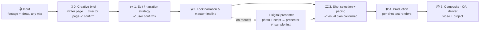

# Xumu (序幕)

<p align="center">
  <a href="./README.md"></a>
  <a href="./README.en.md"></a>
</p>


> 📘 **Usage guide (Chinese): [docs/USAGE.md](./docs/USAGE.md)** · 📝 **Changelog (Chinese): [CHANGELOG.md](./CHANGELOG.md)**

**Xumu** ("序幕", *prologue*) is a **video editing and production skill pack** for AI agents such as Claude, GPT and Doubao: it stands in for the screenwriter, the director and the editor. Hand it **a talking-head video, a recording, a script, loose footage, or just an idea**, and the agent first builds a channel profile and a one-page creative brief (*what it says, what holds it together, what style, how long*) — then edits, picks shots, builds custom motion graphics (MG), adds captions, composites, and delivers **the finished video plus an editable project**. With no on-camera footage, one photo of yourself can become a **digital presenter** that speaks the script (on request, only after you confirm).

It is not a one-click black box but a creative workflow with confirmation points:

- **Plan before cutting** — the writer page fixes the spine, the one-line promise, the storyline and what to keep or cut; the director page fixes style, visual ratio, sound and budget. The channel profile remembers who you are and which series you run, so the second video asks nothing twice.
- **Not everything becomes a card** — keeping the speaker on screen or adding no animation are valid choices; only segments that need motion get shots.
- **Shots with provenance** — compare first choices and alternatives from 124 cinematic shot-recipe cards; write custom MG only when there is a real expressive gap.
- **Style and explanation with method** — a 127-style catalog (59 open-source style packs with full rules, native moves and sample films; 15 with mg-styles-15 reference films), an explainer grammar, 18 composition recipes and 64 expression guides cover everything from film structure and what a sentence does (define, compare, steps, data…) down to local techniques, each with concrete visuals and checks.
- **What it learns, it reuses** — editing videos and tutorials you send become technique cards and style specs that ship with the pack (45 cards and 127 styles so far, including the talking-head presentation family) and are matched to your content automatically.
- **The presenter can be a digital human** — one photo plus the script, MiniMax H3 by default (about 6⚡ a minute, Kling 4.0 and Wan 3.0 as backups); made only when you ask, or when the brief suggests it with a reason and you confirm.
- **Verifiable at every step** — one master timeline, per-shot test renders, a plan checker, and review of real renders.

> Distilled by **VVAI** from real talking-head video production, integrating and adapting [Video Use](https://github.com/browser-use/video-use) (MIT) and [Video Shotcraft](https://github.com/Vincentwei1021/video-shotcraft) (Apache-2.0).

## Workflow



## Quick start (30 seconds)

Whether you use **Claude, GPT, Doubao** or another AI, as long as it can read/write files and run commands (agent / coding mode), just send it this:

```text
Install the "Xumu" video editing skill pack for me. Clone https://github.com/vvai-studio/xumu
into a temp directory, then copy the three folders xumu, video-use and video-shotcraft under skills/
into your skills directory (e.g. ~/.claude/skills/ or ~/.codex/skills/; other agents: wherever they
load skills from). When done, check that each of the three folders contains SKILL.md.
```

After installing, tell your AI:

```text
Use Xumu to turn D:\footage\talk01.mp4 into a ~3-minute 16:9 explainer for YouTube. Show me the production plan first.
```

More things to try:

```text
Turn podcast.m4a into a vertical video for TikTok. Keep the original voice; visuals should be illustrations + diagrams.
I only have a script, script.md. Draft a storyboard and shot plan first — don't generate a voiceover yet.
Make the three data-heavy segments of this talk into animated charts; keep the speaker on screen elsewhere.
This is my previous project, outputs/ai-agents/edit/. Tighten the pacing of chapter 3 and re-export.
I have no on-camera footage. Use my photo D:\photos\me.jpg as a digital presenter and show me one sample segment first.
Learn the editing and style of the talking-head videos in D:\refs\ and add them to the technique library.
```

## What's inside

A pack of **3 skills**. Normally you only start from the director entry point; it calls the other two when needed:

| Skill | Role |
|---|---|
| 🎛 **xumu** | **Entry point**: channel profile and creative brief, edit strategy, shot selection, master timeline, QA and delivery |
| ✂️ **video-use** | Editing tools: transcription, cutting, grading, subtitle burn-in (based on browser-use/video-use) |
| 🎞 **video-shotcraft** | Shot library: 124 shot-recipe cards, Remotion components & template, motion workbench (based on Vincentwei1021/video-shotcraft) |

> 💡 **How to invoke**: the simplest way is to tell your AI "Use Xumu to …". You can also use commands: `/xumu` in Claude (`/xumu:xumu` when installed as a plugin — plugin name before the colon, skill name after), and `$xumu` in GPT (Codex).

## Features

- 🎙 **Any input**: talking-head video (edit the footage) / recording (full-length visuals) / script only (record later, synthetic voiceover, or no narration) / loose footage and photos / just an idea; the writer stage decides what holds the piece together (narration, storyline, script, music), so you never have to name a genre first
- 🗂 **Channel profile**: a brand layer (on-camera style, palette, fonts, voice, no-go list) plus one series layer per kind of content, so your tutorials and your weekend diaries each keep their own look and the second video asks nothing twice; it lives in your workspace and survives updates
- 📝 **Creative brief**: one page per video — the writer page fixes the spine, the one-line promise, the storyline and what to keep or cut; the director page fixes the style direction (3 options with draft frames when you have no idea), visual ratio, sound, budget and freedom level; beginners default to full-auto and the brief's first line always says which mode you are in and where it will stop to ask
- 🧭 **Production profile**: merged from the three layers, each item labelled as coming from this video, the series or the brand with its confirmation state; short pieces and chaptered long-form planned differently
- ✂️ **Voice-first editing**: verbatim transcription, keep lists written as "from this sentence to that one", cut points snapped to real pauses by audio level, frame-exact splicing (audio/video within 1 frame); free local faster-whisper by default; ElevenLabs, Azure or Alibaba Cloud Fun-ASR optional (the cost is shown first and nothing is uploaded without your OK)
- 🎞 **Footage cutting**: when there is no narration, loose clips are split into shots and each gets a usability score (too dark, soft, shaky, too short are flagged at a glance) on a thumbnail wall; shots are picked per storyline segment, optionally rounded to the music's beats, and joined into a rough-cut preview; once settled, visual events can anchor on "the start of that clip" or "beat 12"
- 🖼 **Style gallery**: every one of the 127 styles ships with a representative frame (a generated concept board or a frame taken from a reference video at first; the open-source style packs use real frames from their sample films and link the film online; replaced by a real frame once that style has been used in a film); recommendations show three directions from different families with pictures to pick from; hand it a video you like and say "learn this style" and its cut density, motion, palette and keyframes go into your local reference library, ranking it first next time
- 🖥 **Local board**: one local web page shows the creative brief, channel profile, footage thumbnail wall, style gallery, shots and confirmation gates together; on it you pick a style, confirm a grid or pass a gate, everything else is still said in the chat. Served by the standard library, no frontend to install
- 📐 **Style specs and freedom levels**: each style has a spec (palette, fonts, motion ceiling, reading speed, no-go list); freedom L0–L3 decides how much the AI may improvise (fill-in / tune / 20% custom / free) and a compliance check blocks non-compliant plans before compositing. Weaker models run at low freedom and stay consistent; the same template still looks different per channel because colors and fonts come from the channel profile
- 🔌 **One-step 造物社 (vvai) setup**: say "配置 API" and xumu walks you through setting the key on your own machine (it never passes through the chat), then writes the config, runs a free check and a tiny paid test (one line of voice, one image)
- 🖼 **Images**: GT Image 2.5 Flare by default, every image at 4K and quality high; reference images and transparent backgrounds supported; refunded upstream hiccups retry on the same channel
- 🔊 **Voice and music**: MiniMax speech-2.8 narration — your own cloned voice first, otherwise audition and pick from the platform's built-in voices; short sections are joined into one call to avoid the per-call minimum; Suno instrumental music. Synthetic narration is aligned to the script character by character (homophones and tongue twisters included); sound effects are synthesised locally, free and licence-clean
- 🧑 **Digital presenter (on request)**: one photo of yourself plus the script becomes a talking presenter (MiniMax H3 by default, about 6⚡ a minute; Kling 4.0 and Wan 3.0 as backups); made only when you ask, or when the decision doc suggests it with a reason and you confirm; one sample segment first, and the captions are re-aligned to what the presenter actually says
- 💰 **Paid calls follow rules**: always quoted first; the cheapest channel whose recent success rate passes the bar is used (not blindly the cheapest); it only pauses for you above the limit you set, and a failure never silently retries on another channel
- ⏱ **Times written as "this sentence + offset"**: visual events follow the narration and shift automatically when the opening or the edit changes
- 🎞 **Content-driven shots**: 124 Shotcraft shot-recipe cards (openings, camera moves, transitions, data, typography, rhythm…), comparing first choice and alternatives before committing
- 🎨 **127 visual styles**: explainer, journalism, UI/product, graphic-design schools, illustration and craft, retro, tech, East Asian traditions (ink wash, paper cut, guochao), 3D, talking-head presentation (layout cards, emotional quotes, big-type studio and more), variety-show captions, sticker explainers and more, each with look, signature motion, best-fit content and ready implementations; 59 come from the [Lemo-Opuscar](https://github.com/lemomo-ai/lemo-opuscar) open-source style packs (caption news, visual investigation, archive light table, satellite briefing, shadow puppetry, paper-cut lightbox, HD-2D, brick toy…, catalogued in Chinese by [Chaojifeng](https://github.com/mileson/chaojifeng-video-design)), each with full rules, a native-move menu, a sample film and reusable deterministic source; 15 link to reference films from [mg-styles-15](https://github.com/Vincentwei1021/mg-styles-15)
- 🧱 **Composition recipes and expression guides**: 18 recipes (evidence-board news brief, layered concept reveal, launch-film arc…) give a storyline its step-by-step structure and can draft decision-doc grid 4 in one command; 64 expressions (shared-form morph, read-then-move, keep attention on the main voice…) give a shot's local technique its parameters, no-go rules and review questions
- 🗣 **Explainer grammar**: 20 sentence functions mapped to visual organization, an anti-slideshow checklist and phone-readable type sizes
- 🧩 **Whiteboard one-take template**: world-coordinate camera, drawing hand, hand-drawn monitor hand-offs into real screen recordings, circular talking head, plus 7 recipes that draw what each agent or role does as it is introduced; verified in a 7-minute film (HyperFrames)
- ✨ **Custom MG**: 32 curated inspiration entries + brief template + a **frame-deterministic rendering contract** (every frame depends only on its frame number)
- 📚 **Learning mode**: send it editing examples, style references or tutorials; it distills them into technique cards that are reused when content matches; 35 learned cards ship with it (talking-head openers, text behind the speaker, word-by-word captions, seven talking-head layouts and more)
- 🔎 **Motion reference search** (optional): one command downloads 637 effect cards and HyperFrames component metadata, searchable with Chinese or English keywords
- 🎬 **Reference clip first**: for long films or a style new to the project, the first 60–90 s are made in the full style for your OK before the rest is built
- 🧱 **One master timeline**: `visual-plan.json` + `plan_tools.py` structural checks and hand-off manifest export
- ♻️ **Change one thing, not the whole film**: each shot records a render fingerprint; after an edit, `plan_tools.py diff` lists which shots need re-rendering and which only moved and can be reused; word-synced moments inside a shot follow the cut
- 🔌 **HyperFrames**: can be the main composition engine (e.g. the whiteboard one-take); otherwise used on demand for behind-subject captions, effects Shotcraft lacks, or music/SFX, always under Xumu's control
- 🛠 **One-command setup**: `setup_env.py` checks and installs on its own: FFmpeg, Python deps, faster-whisper, Node.js, the Remotion cache and the motion reference index, without asking item by item; it test-loads the transcription model in a separate process and repairs the ctranslate2 crash seen on some Windows PCs

## Good fit / not a fit

**✅ Good fit**: educational talking-head / commentary / tutorials / podcast clips / product and proposal explainers / chaptered long-form video / talking-head pieces with no footage, using your own digital presenter

**❌ Not a fit**: music videos / multi-camera film editing / people who want a double-click editing app / environments where the agent cannot run commands

## Common scenarios

| Task | Recommended approach |
|------|---------|
| Polish and package a talking-head video | Video mode: confirm the cut strategy first; keep speaker segments; data/process segments get shots or MG |
| Turn a podcast / recording into a video | Audio mode: keep the original voice; visuals must **cover the full length** (illustration, screen recording, diagrams, designed backgrounds) |
| Script only | Script mode: structure and storyboard first; then record later, synthetic voiceover, or a caption-only video |
| Explaining data or processes | Compare Shotcraft data/typography recipes first; write a custom MG brief only if they fall short |
| Long-form (10 min+) | Chaptered planning, each chapter with its own pacing and return-to-speaker beats |
| A photo but no on-camera footage | The brief (grid 7) says why a digital presenter fits; after you confirm, one sample segment first to check gestures, then the rest; your cloned voice is the voice reference |
| Learn someone's editing and style | Learning mode: you confirm each technique card; styles go into the style library (frames taken from the video) and ship with the pack |
| Revise an existing project | Point the agent at the project's `edit/` folder; only affected shots and captions are redone, unchanged sources are not re-transcribed |

## Usage rules (summary)

Full version (Chinese): **[docs/USAGE.md](./docs/USAGE.md)**.

1. **State four things up front**: platform, audience, style and rough length. The agent asks about what's missing — but only what would change the result.
2. **Two confirmation points are mandatory**: the edit/narration strategy and the full visual plan. A vague "make a video" is not approval to cut.
3. **Source footage is never overwritten**: all outputs go to `edit/` next to your footage, or `outputs/<project-name>/edit/`.
4. **Permissions stay scoped**: publishing, voice cloning, uploading media and paid generation each need your separate approval; a digital presenter uses only your own photo (or one whose subject agreed) and is made only when you ask or confirm the brief's suggestion; API keys live only in environment variables, never in plans or logs.
5. **Bring your own licensed audio**: this repo ships **no** third-party music or SFX. Use music you hold a licence for, or generate it through your own configured provider; sound effects are sourced from Freesound (CC0 by default, via Shotcraft's sourcing script, provenance and licence recorded) and UI cues are synthesised locally.
6. **Judge real renders**: a passing `plan_tools.py check` means the structure is valid, not that the video is good; a matching transcript doesn't mean the voice sounds smooth, so unheard audio is reported as "awaiting a listen".
7. **No downgraded deliverables**: before final delivery the agent runs `media_tools.py deliver-check`; the video must not be smaller than the source footage (portrait 1080×1920 and up) or it is not delivered. Draft/preview renders carry "draft/preview" in the file name and are never shipped as the final video.

## Platform support

| AI | Status | Notes |
|------|------|------|
| Claude (Claude Code / desktop Cowork) | Supported | Can be installed as a plugin in one step; invoke with `/xumu` |
| GPT (Codex) | Supported | Place in `~/.codex/skills/`; trigger with `$xumu` |
| Doubao | Usable | Requires an agent / coding mode that can read/write files and run commands |
| Cursor / other AI agents | Usable | Must be able to read/write files and run shell commands |
| Web / app chat (ChatGPT, Claude web, etc.) | **Not supported** | Editing and rendering run on your computer, so the web apps can neither install nor run it |

> One rule decides it: **can your AI read/write files and run commands on your computer?** If yes, it can run Xumu.

## Installation

> 🔒 **Invitation only**: this repository is private; only people the author invites can download and update it. Ask the author for an invitation, accept it, then run `gh auth login` once on your computer so the installation steps below can reach the repository.
>
> ⚠️ **Desktop only.** Do not upload the zip from GitHub to a web app's Skills page, and do not ask a web chat AI to install it; both fail.

### Option 1: send this to your AI (universal, recommended)

> Install the "Xumu" skill pack for me:
>
> 1. Run `git clone https://github.com/vvai-studio/xumu.git` into a temp directory
> 2. Find the directory you load skills from; create it if it doesn't exist
> 3. Copy **all three folders** `skills/xumu`, `skills/video-use` and `skills/video-shotcraft` into it
> 4. Verify each folder contains `SKILL.md`
> 5. Tell me when it's done; from then on, saying "turn this talk into a video" will trigger it

### Option 2: manual command line

macOS / Linux:

```bash
git clone https://github.com/vvai-studio/xumu.git
cp -r xumu/skills/* ~/.claude/skills/
```

Windows (PowerShell):

```powershell
git clone https://github.com/vvai-studio/xumu.git
Copy-Item -Recurse xumu\skills\* "$HOME\.claude\skills\"
```

The example uses Claude's `~/.claude/skills/`; for GPT (Codex) use `~/.codex/skills/`, for other AIs use the directory they load skills from.

### Option 3: Claude plugin commands (Claude Code only)

```text
/plugin marketplace add vvai-studio/xumu
/plugin install xumu@vvai
```

Update: `/plugin marketplace update vvai`, then `/plugin install xumu@vvai` again.

**Update notice**: on every start Xumu compares its version with the published version list in the background (at most once per 10 minutes, 2 s timeout, nothing uploaded). When a newer version exists it adds one line with the version and the update command at the end of that reply, at most once a day, and never updates itself. Turn it off with the environment variable `XUMU_UPDATE_CHECK=off`. The free edition (without the learned technique cards and the Opuscar style packs) lives in the public repository [vvai-xumu-publicversion](https://github.com/vvai-studio/vvai-xumu-publicversion).

> ⚠️ **All three skills must live in the same `skills/` directory.** The director skill finds video-use and video-shotcraft as siblings; it never relies on absolute paths from the author's machine.

### Requirements

| Dependency | Purpose | How to get it |
|---|---|---|
| Python 3.10+ | Editing, transcription, plan checks | Install yourself |
| FFmpeg / ffprobe | Media processing and compositing | Installed by `setup_env.py` |
| faster-whisper | Free local transcription | Installed by `setup_env.py` |
| Node.js 18+ | Remotion animation rendering | Installed by `setup_env.py` (winget / brew / apt), which also pre-fetches the Remotion packages |
| ElevenLabs API key | Optional: cloud transcription + speaker diarization | Set the `ELEVENLABS_API_KEY` environment variable |
| Azure Speech key | Optional: Azure fast transcription | `AZURE_SPEECH_KEY` plus `AZURE_SPEECH_ENDPOINT` or `AZURE_SPEECH_REGION` |
| Alibaba Cloud Model Studio key | Optional: Fun-ASR transcription (international) | `DASHSCOPE_API_KEY` |
| 造物社 (vvai) API key | Optional: images, narration, music, digital presenter | Environment variable `VVAI_API_KEY`; tell the agent "配置 API" and it opens a local page where you paste the key (no terminal needed; the same for changing keys; `audio_cloud.py setup` writes the config, `doctor` checks it). Other providers: see the example config |

The first time, the agent runs the `first_run.py` entry point in the background: it installs the free dependencies, builds the motion reference index, opens a local page for you to paste your 造物社 key, writes the config and runs the free check-up, then hands you the checklist; after that every production run only needs the quick `setup_env.py`. You can also run them by hand:

```bash
python skills/xumu/scripts/first_run.py            # first time: the single entry point (--no-key skips the key page, --smoke runs the paid test)
python skills/xumu/scripts/setup_env.py --check   # report only, install nothing
python skills/xumu/scripts/setup_env.py            # install whatever is missing (incl. Remotion cache and motion index)
python skills/xumu/scripts/setup_env.py --no-remotion --no-refs   # skip the Remotion pre-fetch and the motion index
```

## Repository layout

```text
xumu/
├── .claude-plugin/
│   ├── plugin.json            # plugin manifest
│   └── marketplace.json       # marketplace manifest (for /plugin marketplace add)
├── skills/
│   ├── xumu/                  # 🎛 director: SKILL.md + agents/ (identities) + references/ + scripts/
│   ├── video-use/             # ✂️ editing helpers (MIT, original license kept)
│   └── video-shotcraft/       # 🎞 shot cards + Remotion source (Apache-2.0, original license kept)
├── docs/USAGE.md              # usage guide (Chinese)
├── CHANGELOG.md               # changelog (Chinese)
├── CONTRIBUTING.md            # contributing guide
├── THIRD_PARTY_NOTICES.md     # third-party sources and licenses
└── LICENSE                    # MIT (covers VV original work only)
```

## Project outputs

Each video project produces, under `edit/` (generated as needed, never pre-filled with made-up results):

| File | Purpose |
|---|---|
| `project.md` | Production profile, confirmations, notes for picking up later |
| `edl.json` | Edit decision list (when Video Use is used) |
| `visual-plan.json` | **The one master timeline**: frame-level timing and shots |
| `assets.json` | Asset sources and licenses |
| `shots/<shot_id>/` | One folder per shot; custom MG includes `brief.md` |
| `avatar/` | Digital presenter: segment plan, segment videos, `final_avatar.mp4`, QA `qc.json` and anomaly times `anomalies.json` (only when used) |
| `verify/` | QA evidence; `verify/listen/` holds a listening reel of cut points and suspected stumbles; `verify/deliver_check.json` is the delivery-spec report of the final video against the source |

## License & credits

- VV original work (`skills/xumu/`, root docs and config) is open-sourced under [MIT](./LICENSE).
- [`skills/video-use/`](./skills/video-use/) comes from [browser-use/video-use](https://github.com/browser-use/video-use) and keeps its MIT license.
- [`skills/video-shotcraft/`](./skills/video-shotcraft/) comes from [Vincentwei1021/video-shotcraft](https://github.com/Vincentwei1021/video-shotcraft) and keeps its Apache-2.0 license; the upstream Mixkit SFX/music are **not redistributed** here.
- Style reference films come from [Vincentwei1021/mg-styles-15](https://github.com/Vincentwei1021/mg-styles-15) (MIT); `motion_index.py fetch` downloads them locally, they are not redistributed here.
- The 59 open-source style packs come from LemoLab's [Lemo-Opuscar](https://github.com/lemomo-ai/lemo-opuscar) (rules and source MIT, frames and films CC BY 4.0): representative frames ship with the pack, full rules and source download with `motion_index.py fetch`, sample films on demand; the Chinese catalogue, composition recipes and expression guides are adapted from [mileson/chaojifeng-video-design](https://github.com/mileson/chaojifeng-video-design) (MIT).
- See [THIRD_PARTY_NOTICES.md](./THIRD_PARTY_NOTICES.md).

Issues and PRs are welcome — see [CONTRIBUTING.md](./CONTRIBUTING.md).
