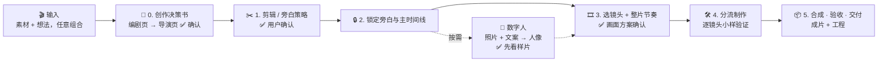

# 序幕

<p align="center">
  <a href="./README.md"></a>
  <a href="./README.en.md"></a>
</p>


> 📘 **使用规范：[docs/USAGE.md](./docs/USAGE.md)** · 📝 **更新日志：[CHANGELOG.md](./CHANGELOG.md)**

一个适配 Claude、GPT、豆包等 AI Agent 的**剪辑成片技能包**，替代编剧、导演和剪辑师。把**口播视频、录音、文案、零散素材，或只是一个想法**交给 Agent，它会先建频道档案、出一页创作决策书（讲什么、靠什么串起来、什么风格、多长），再完成剪辑、选镜头、定制动态图形（MG）、字幕与合成，最后交付**成片 + 可继续修改的工程**。没有出镜素材时，也可以用一张本人照片生成按文案说话的**数字人**（按需，你确认才做）。

它不是「一键出片」的黑盒，而是一套有确认点的创作工作流：

- **先想清楚再动手**：编剧页定脊梁、一句话、故事线和删留，导演页定风格、画面比例、声音和预算；频道档案记住你是谁、有哪几个栏目，第二部片不用重问。
- **不把所有内容都变成卡片**：保留人物、不加动画也是有效决策；需要动态呈现的段落才去选镜头。
- **镜头有出处**：从 124 张电影感镜头配方卡里比较首选与备选，确有表达缺口才写定制 MG。
- **风格与讲法有章法**：127 种画面风格目录（含 59 套带完整规则、原生动作和样片的开源风格包，15 种附 mg-styles-15 参考成片）+ 解说语法表 + 18 类组合配方 + 64 项表达指导，从整片结构、"这句话在做什么"到局部手法都有对应的画面和检查。
- **学过的会复用**：发给它的剪辑视频和教程归纳成手法卡、风格规范，随包共享（已有 45 张手法卡、127 种风格，含「口播呈现」大类），做片时按内容自动调用。
- **人可以是数字人**：一张本人照片 + 文案，默认 MiniMax H3 生成开口说话的人像（1 分钟约 6⚡，备选可灵 4.0、Wan 3.0）；只在你要求、或决策书写明理由建议并经你确认时才做。
- **每一步可验证**：唯一主时间线、逐镜头小样验证、结构检查工具、真实渲染验收。

> 由 **VVAI** 在实际口播视频制作中沉淀而成，整合并适配了 [Video Use](https://github.com/browser-use/video-use)（MIT）与 [Video Shotcraft](https://github.com/Vincentwei1021/video-shotcraft)（Apache-2.0）。

## 工作流一览



## 30 秒开始

不管你用 **Claude、GPT、豆包**还是其他 AI，只要它能读写文件、执行命令（Agent / 智能体 / 编程模式），把这段话直接发给它：

```text
帮我安装「序幕」剪辑成片技能包。请把 https://github.com/vvai-studio/xumu 克隆到临时目录，
再把其中 skills/ 下的 xumu、video-use、video-shotcraft 三个文件夹一起复制到你的 skills 目录
（例如 ~/.claude/skills/ 或 ~/.codex/skills/，其他 Agent 请放到它读取技能的目录），
安装完成后检查三个文件夹里都有 SKILL.md。
```

安装后直接对 AI 说：

```text
用序幕，把 D:\素材\口播01.mp4 做成 B 站横屏解说视频，3 分钟左右，先给我制作方案。
```

也可以试这些请求：

```text
这段录音 podcast.m4a 帮我做成小红书竖屏视频，保留原声，画面用插画 + 图解。
我只有一份文案 script.md，先帮我出分镜和镜头方案，不要生成配音。
把这支口播里讲数据的三段做成动态图表，其他段落保留人物画面。
这是上次的项目 outputs/ai-agents/edit/，把第 3 章节奏改快一点，重新导出。
我没有出镜素材，用我这张照片 D:\照片\本人.jpg 做数字人口播，先跑一段样片给我看。
学一下 D:\参考 文件夹里这几条口播视频的剪法和风格，收进手法库。
```

## 包含什么

这是一个包含 **3 个 skill** 的技能包，平时只需要从总控入口开始，它会在需要时调用另外两个：

| Skill | 作用 |
|---|---|
| 🎛 **xumu** | **总控入口**：频道档案与创作决策书、剪辑策略、选镜头、主时间线、验收与交付 |
| ✂️ **video-use** | 剪辑工具：转录、剪切、调色、字幕烧录（基于 browser-use/video-use） |
| 🎞 **video-shotcraft** | 镜头库：124 张镜头配方卡、Remotion 组件与模板、动效工作台（基于 Vincentwei1021/video-shotcraft） |

> 💡 **怎么调用**：最简单的是直接对 AI 说「用序幕……」。也可以用命令：Claude 里是 `/xumu`（以插件方式安装时为 `/xumu:xumu`，冒号前是插件名、冒号后是 skill 名），GPT（Codex）里是 `$xumu`。

## 效果

- 🎙 **任意输入**：口播视频（剪辑原片）/ 录音（全片配画面）/ 纯文案（原声后录、合成配音或无旁白）/ 零散素材与照片 / 只有一个想法；片子靠什么串起来（旁白、故事线、剧本、音乐）由编剧阶段判断，不用你先说是哪类片
- 🗂 **频道档案**：品牌层（人像、配色、字体、声音、禁区）+ 栏目层（一类内容的做法），一个人做教程和记录两个栏目各有各的风格，第二部片不再重问；档案存在你的工作区，更新不覆盖
- 📝 **创作决策书**：每部片一页——编剧页定脊梁、一句话、故事线、删留，导演页定风格方向（没想法时给 3 个方向配效果草稿）、画面比例、声音、预算与自由度；新手默认全托，决策书顶部写明当前模式和会在哪几处停下来问
- 🧭 **制作定位**：由三层档案合并得出，每项标注来自本片 / 栏目 / 品牌和确认状态；短篇与章节式长片分别规划
- ✂️ **原声剪辑**：逐字转录，按"从哪句到哪句"写保留表，剪点按音量对到真实停顿，帧精确拼接（音画误差不超过 1 帧）；默认本地免费 faster-whisper，可选 ElevenLabs、Azure、阿里云 Fun-ASR 云端转录（转录前先列出费用，同意才上传）
- 🎞 **剪素材**：没有旁白时，把零散片段切成镜头、每个打可用度分（过暗、偏糊、抖乱、太短一眼看出），出一面缩略图墙；按故事线自动选段、按音乐节拍取整，拼成粗剪预览试看；定下后画面事件可以锚在"某段素材的开头"或"第几拍"上
- 🖼 **风格画廊**：127 种风格每种一张代表帧随包附带（生图示意板或从参考视频截的帧，开源风格包是样片真帧并带在线样片链接，做过成片后换成真帧），推荐时从不同大类各给一个、贴图让你点；贴一支喜欢的片子说"学这个风格"，切点密度、运动量、色板、关键帧进你本机的参考片库，以后推荐时排前
- 🖥 **本地看板**：一个本机网页把创作决策书、频道档案、素材缩略图墙、风格画廊、镜头与确认点放在一起看；你在上面点风格、确认某一格、过确认点，其余还是在对话框里说。标准库起服务，不用装前端
- 📐 **风格规范与自由度**：每种风格有色板、字体、动作档位上限、阅读速度、禁用项的规范；自由度 L0～L3 决定 AI 能发挥多少（填空 / 调参 / 两成定制 / 自由），合规检查不过不进合成。弱一点的模型用低自由度，出来的片子稳；同一模板不同频道各有自己的配色字体，不会千篇一律
- 🔌 **造物社一键接入**：说"配置 API"，序幕告诉你怎么在自己电脑上设好密钥（密钥不经过聊天），再自动写好配置、免费体检、试跑一句配音和一张图
- 🖼 **生图**：默认 GT Image 2.5 Flare，每张 4K + 高质量；支持参考图、透明底；提示词出错不扣费、同渠道自动重试
- 🔊 **配音与配乐**：海螺语音克隆 2.8 配音——优先用你自己的声音，没有就从平台自带音色里试听挑选；短段自动合并成一次调用，省掉每次的最低收费；Suno 生成纯音乐配乐。合成旁白按原文逐字对齐（同音字、绕口令也对得上）；音效用本地合成，不花钱也没有授权问题
- 🧑 **数字人（按需）**：一张本人照片 + 文案，生成开口说话的口播人像（默认 MiniMax H3，1 分钟约 6⚡；备选可灵 4.0、Wan 3.0）；只在你要求、或决策书写明理由建议并经你确认时才做，先跑一段样片看手势再全量，拼好后按实际说的话重新逐字对齐字幕
- 💰 **付费调用有规矩**：每次先报价，在成功率达标的渠道里选最便宜的（不是盲选最低价），超出你设的额度才停下来问，失败不会自动换渠道重复扣费
- ⏱ **时间写成"哪句话 + 偏移"**：画面事件跟着口播走，插入开场或改剪辑后自动顺延，不用逐处改秒数
- 🎞 **内容选镜头**：124 张 Shotcraft 镜头配方卡（开场、运镜、转场、数据、排版、节奏…），先比较首选与备选再定案
- 🎨 **127 种画面风格**：教学解说、新闻纪实、界面产品、平面设计流派、插画手作、复古、科技、东方传统（水墨、剪纸、国潮）、三维、口播呈现（板式卡、情感金句、大字棚拍等）、综艺花字、贴纸科普等，每种写明观感、标志动作、适合内容和现成实现；其中 59 种来自 [Lemo-Opuscar](https://github.com/lemomo-ai/lemo-opuscar) 开源风格包（字幕新闻、视觉调查、档案灯台、卫星简报、皮影戏、纸雕灯影、HD-2D、积木玩具……，经 [超级峰](https://github.com/mileson/chaojifeng-video-design) 整理中文目录），每种有完整规则、原生动作菜单、一支样片和可复用的确定性源码；15 种可直接看 [mg-styles-15](https://github.com/Vincentwei1021/mg-styles-15) 的参考成片
- 🧱 **组合配方与表达指导**：18 类配方（证据板讲清资讯、逐层递进讲清抽象概念、发布片情绪弧……）给故事线分步结构，一条命令套进决策书第 4 格起草；64 项表达（共享形体过渡、先读后动、把注意留给主要声音……）给镜头局部手法的参数、禁区和检查问题
- 🗣 **解说语法**：20 种句子作用 → 画面组织方式 + 去 PPT 感清单 + 手机可读字号
- 🧩 **白板一镜到底模板**：世界坐标镜头、画笔手、手绘显示器衔接真实录屏、圆形人像，外加 7 套"讲到某个 Agent / 岗位就画出它在做什么"的动画配方；已在 7 分钟成片中验证（HyperFrames）
- ✨ **定制 MG**：32 条精选灵感索引 + brief 模板 + **逐帧确定性渲染契约**（画面只由帧号决定）
- 📚 **学习模式**：把喜欢的剪辑视频、风格案例或教程发给它，归纳成"手法卡"，以后按内容自动调用；随包附带 45 张已学的手法卡（口播开场、字在人后、逐词字幕、七种口播板式等）
- 🔎 **动效参考检索**（可选）：一条命令下载 637 张动效卡与 HyperFrames 组件说明，用中文关键词检索
- 🎬 **先出参考片**：长片或第一次用的风格，先用完整风格做前 60–90 秒给你确认，再铺全片
- 🧱 **唯一主时间线**：`visual-plan.json` + `plan_tools.py` 结构检查与交接清单导出
- ♻️ **改一处不重做整片**：每个镜头记录渲染指纹，修改后 `plan_tools.py diff` 列出哪些镜头要重渲、哪些只挪位置可复用；剪辑后镜头内部跟字的时刻自动顺延
- 🔌 **HyperFrames**：可作主合成引擎（如白板一镜到底）；另在「背后字幕 / Shotcraft 缺的效果 / 配乐音效」三种情况下按需调用，始终由序幕总控
- 🛠 **一键环境**：`setup_env.py` 自检自装：FFmpeg、Python 依赖、faster-whisper、Node.js、Remotion 缓存、动效参考索引，缺什么装什么、不逐项询问；在独立进程里试加载转录模型，遇到部分 Windows 电脑上的 ctranslate2 崩溃会自动改装可用版本

## 适合 / 不适合

**✅ 合适**：知识科普口播 / 观点评论 / 教程讲解 / 播客切片 / 产品与方案讲解 / 章节式长视频 / 没有出镜素材、想用本人数字人出镜的口播

**❌ 不合适**：纯音乐 MV / 多机位影视剪辑 / 需要双击即用的剪辑软件 / 不允许 Agent 执行命令的环境

## 常见使用场景

| 任务 | 推荐方式 |
|------|---------|
| 口播视频做精剪 + 包装 | 视频模式：先确认删减策略，人物段保留，数据/流程段落上镜头或 MG |
| 播客 / 录音做成视频 | 音频模式：保留原声，画面需要**完整覆盖全片**（插画、录屏、图解、设计背景） |
| 只有文案 | 文案模式：先出结构和分镜；再选择原声后录、合成配音或无旁白字幕片 |
| 讲数据、讲流程 | 先比较 Shotcraft 数据/排版类配方，不够再写定制 MG brief |
| 长视频（10 分钟+） | 章节式规划，每章独立节奏与回归人物的节点 |
| 只有照片、没有出镜素材 | 决策书第 7 格写明为什么适合数字人，你确认后先生成一段样片看手势，再全量；声音用你的克隆音色作参考 |
| 学别人的剪法和风格 | 学习模式：拆解后给你逐张确认手法卡，风格进风格库（代表帧从视频截取），随包共享 |
| 修改已有项目 | 指向项目的 `edit/` 目录，只重做受影响的镜头和字幕，不重转录未变化的源文件 |

## 使用规范（摘要）

完整版见 **[docs/USAGE.md](./docs/USAGE.md)**。

1. **先说清四件事**：发到哪个平台、给谁看、想要什么风格、大概多长。缺的 Agent 会问，但只问会影响结果的。
2. **两个确认点必须过**：剪辑/旁白策略确认、整片画面方案确认。笼统的「做个视频」不等于批准删改。
3. **素材不会被覆盖**：所有产物写在素材目录下的 `edit/`，或 `outputs/<项目名>/edit/`。
4. **授权不越界**：发布、克隆声音、上传素材、付费生成都需要你单独同意；数字人只用本人照片（或已取得本人同意的照片），只在你要求或决策书建议并经你确认时生成；API Key 只放环境变量，不写进计划和日志。
5. **音频自备授权**：本仓库**不包含**任何第三方音乐/音效文件。配乐用你自己有授权的音乐，或经你自己配置的服务商生成；音效先从 Freesound 选 CC0 真实声音（经 Shotcraft 的选材脚本，自动记来源与许可），UI 提示音本地合成。
6. **验收看真实渲染**：`plan_tools.py check` 通过只代表结构正确，不代表成片质量通过；转录对得上也不代表口播听起来顺，没试听过的声音标为「待试听确认」。
7. **交付不降规格**：正式交付前跑 `media_tools.py deliver-check`，成片分辨率不得低于原素材（竖屏 1080×1920 起），不通过不交付；草稿/预览渲染文件名带「草稿/预览」字样，不当成片交付。

## 平台支持

| AI | 状态 | 说明 |
|------|------|------|
| Claude（Claude Code / 桌面版 Cowork） | 支持 | 可用插件方式一次装齐，调用 `/xumu` |
| GPT（Codex） | 支持 | 放到 `~/.codex/skills/`，用 `$xumu` 触发 |
| 豆包 | 可用 | 需使用能读写文件、执行命令的智能体 / 编程模式 |
| Cursor / 其他 AI Agent | 可用 | 需要能读写文件、执行 shell 命令 |
| 网页 / App 聊天（ChatGPT、Claude 网页版等） | **不支持** | 剪辑和渲染要在你的电脑上执行，网页版装不了也跑不起来 |

> 判断标准只有一个：**你的 AI 能不能在你电脑上读写文件、运行命令**。能，就能用序幕。

## 安装

> 🔒 **授权使用**：本仓库为私有，只有获得作者邀请的人能下载和更新。使用前请联系作者获取邀请；接受邀请后，在自己电脑上运行一次 `gh auth login` 登录 GitHub，下面的安装方式才能访问仓库。
>
> ⚠️ **只能在电脑端安装和使用。** 不要把 GitHub 下载的 zip 上传到网页版的「技能」页面，也不要让网页聊天里的 AI 代装，都会失败。

### 方式一：把下面这段话直接发给 AI（通用，推荐）

> 帮我安装「序幕」技能包。请按下面步骤做：
>
> 1. 执行 `git clone https://github.com/vvai-studio/xumu.git` 到一个临时目录
> 2. 找到你读取技能（skills）的目录，不存在就创建
> 3. 把其中 `skills/xumu`、`skills/video-use`、`skills/video-shotcraft` **三个文件夹**都复制进去
> 4. 验证三个文件夹里都有 `SKILL.md`
> 5. 告诉我安装好了，之后我说「把这段口播做成视频」就会触发

### 方式二：手动命令行

macOS / Linux：

```bash
git clone https://github.com/vvai-studio/xumu.git
cp -r xumu/skills/* ~/.claude/skills/
```

Windows（PowerShell）：

```powershell
git clone https://github.com/vvai-studio/xumu.git
Copy-Item -Recurse xumu\skills\* "$HOME\.claude\skills\"
```

上面以 Claude 的 `~/.claude/skills/` 为例；GPT（Codex）换成 `~/.codex/skills/`，其他 AI 换成它读取技能的目录。

### 方式三：Claude 插件命令（仅 Claude Code）

```text
/plugin marketplace add vvai-studio/xumu
/plugin install xumu@vvai
```

更新：`/plugin marketplace update vvai` 后重新 `/plugin install xumu@vvai`。

**更新提示**：序幕每次启动会在后台比对公开的版本列表（10 分钟内最多一次、2 秒超时、不上传任何内容），发现新版本只在当次回复末尾提示一行版本号与更新命令，一天最多一次，不会自动更新。关闭提示：环境变量 `XUMU_UPDATE_CHECK=off`。免费版（不含学到的手法卡与 Opuscar 风格包）在公开仓库 [vvai-xumu-publicversion](https://github.com/vvai-studio/vvai-xumu-publicversion)。

> ⚠️ **三个 skill 必须放在同一个 `skills/` 目录下**。总控 skill 通过「同级目录」找到 video-use 和 video-shotcraft，不依赖任何作者电脑上的绝对路径。

### 运行环境

| 依赖 | 用途 | 如何获得 |
|---|---|---|
| Python 3.10+ | 剪辑、转录、计划检查 | 自行安装 |
| FFmpeg / ffprobe | 媒体处理与合成 | `setup_env.py` 自动安装 |
| faster-whisper | 本地免费转录 | `setup_env.py` 自动安装 |
| Node.js 18+ | Remotion 动画渲染 | `setup_env.py` 自动安装（winget / brew / apt），并预取 Remotion 依赖 |
| ElevenLabs API Key | 可选：云端转录 + 说话人区分 | 设置环境变量 `ELEVENLABS_API_KEY` |
| Azure Speech Key | 可选：Azure 快速转录 | 环境变量 `AZURE_SPEECH_KEY`，加 `AZURE_SPEECH_ENDPOINT` 或 `AZURE_SPEECH_REGION` |
| 阿里云 Model Studio Key | 可选：Fun-ASR 转录（国际版） | 环境变量 `DASHSCOPE_API_KEY` |
| 造物社 API 密钥 | 可选：生图、配音、配乐、数字人 | 环境变量 `VVAI_API_KEY`；对 Agent 说"配置 API"，它会打开本机网页让你粘贴密钥（不用终端，换密钥也一样），`audio_cloud.py setup` 写配置、`doctor` 检查。其他服务商见示例配置 |
| 动效参考库 | 必备：导演做画面方案时每段自动检索 | `setup_env.py` 自动拉取并建索引（约 155MB，需要 git 与网络）；也可手动 `motion_index.py fetch` 后 `build` |

第一次用时 Agent 会后台运行总入口 `first_run.py`：装齐免费依赖、建动效索引、打开本机网页让你贴造物社密钥、写好配置、免费体检，跑完给你一张清单；之后每次制作前只跑秒级的 `setup_env.py`。也可以手动：

```bash
python skills/xumu/scripts/first_run.py            # 第一次：总入口（--no-key 跳过密钥网页，--smoke 付费试跑）
python skills/xumu/scripts/setup_env.py --check   # 只报告，不安装
python skills/xumu/scripts/setup_env.py            # 缺什么装什么（含 Remotion 缓存与动效索引）
python skills/xumu/scripts/setup_env.py --no-remotion --no-refs   # 跳过 Remotion 预取与动效索引
```

## 仓库结构

```text
xumu/
├── .claude-plugin/
│   ├── plugin.json            # 插件清单
│   └── marketplace.json       # 插件市场清单（/plugin marketplace add 用）
├── skills/
│   ├── xumu/                  # 🎛 总控：SKILL.md + agents/（身份）+ references/ + scripts/ + assets/templates/ + library/
│   ├── video-use/             # ✂️ 剪辑 helper（MIT，保留原许可证）
│   └── video-shotcraft/       # 🎞 镜头卡库 + Remotion 源码（Apache-2.0，保留原许可证）
├── docs/USAGE.md              # 使用规范
├── CHANGELOG.md               # 更新日志
├── CONTRIBUTING.md            # 贡献规范
├── THIRD_PARTY_NOTICES.md     # 第三方来源与授权
└── LICENSE                    # MIT（仅覆盖 VV 原创部分）
```

## 项目产物

每个视频项目在 `edit/` 下产生（按需生成，不预填虚构结果）：

| 文件 | 作用 |
|---|---|
| `project.md` | 制作定位、确认记录、续作说明 |
| `edl.json` | 剪辑决定表（使用 Video Use 时） |
| `keeps.json` / `edl_voice.json` | 口播保留表与帧对齐剪辑表（`voice_edit.py`） |
| `cue_chars.json` / `sections.json` / `timing.json` | 逐字时间表、段落起止、插入段登记，供"哪句话 + 偏移"换算时间 |
| `visual-plan.json` | **唯一主时间线**：帧级时序与镜头 |
| `assets.json` | 素材来源与授权 |
| `shots/<shot_id>/` | 每个镜头独立目录；定制 MG 附 `brief.md` |
| `avatar/` | 数字人：分段计划、各段视频、`final_avatar.mp4`、质检 `qc.json` 与异常时间段 `anomalies.json`（按需生成） |
| `verify/` | 验收证据；`verify/listen/` 是剪点与疑似卡壳处的试听合集；`verify/deliver_check.json` 是成片对照原素材的交付规格报告 |

## 许可证与致谢

- VV 原创部分（`skills/xumu/`、仓库根目录文档与配置）以 [MIT](./LICENSE) 开源。
- [`skills/video-use/`](./skills/video-use/) 来自 [browser-use/video-use](https://github.com/browser-use/video-use)，保留其 MIT 许可证。
- [`skills/video-shotcraft/`](./skills/video-shotcraft/) 来自 [Vincentwei1021/video-shotcraft](https://github.com/Vincentwei1021/video-shotcraft)，保留其 Apache-2.0 许可证；原项目的 Mixkit 音效/音乐**未随本仓库分发**。
- 风格参考片来自 [Vincentwei1021/mg-styles-15](https://github.com/Vincentwei1021/mg-styles-15)（MIT），按需用 `motion_index.py fetch` 下载到本机，不随本仓库分发。
- 59 套开源风格包来自 LemoLab 的 [Lemo-Opuscar](https://github.com/lemomo-ai/lemo-opuscar)（规则与源码 MIT，代表帧与样片 CC BY 4.0）：代表帧随包，规则全文与源码用 `motion_index.py fetch` 下载，样片按需下载；中文目录、组合配方与表达指导改编自 [mileson/chaojifeng-video-design](https://github.com/mileson/chaojifeng-video-design)（MIT）。
- 详见 [THIRD_PARTY_NOTICES.md](./THIRD_PARTY_NOTICES.md)。

欢迎提 Issue 和 PR，参与方式见 [CONTRIBUTING.md](./CONTRIBUTING.md)。
